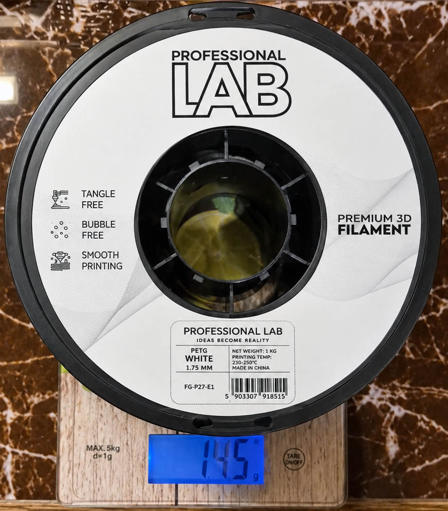

+++
draft = false
image = "img/portfolio/spool_professional_lab_petg_white_1kg.jpg"
showonlyimage = false
date="2026-11-08"
title = "Professional Lab PETG White 1KG"
[params]
  spool_type = 'dark_plastic'
+++

* Printing temp: 230 C – 250 C
* Bed temp: 70 C
* Empty spool weight: 145 g
* Advertised filament weight: 1000 g
* Outside Diameter: 197.9 mm
* Height: 63.5 mm
* Hole Diameter: 57.7 mm
<!--more-->

