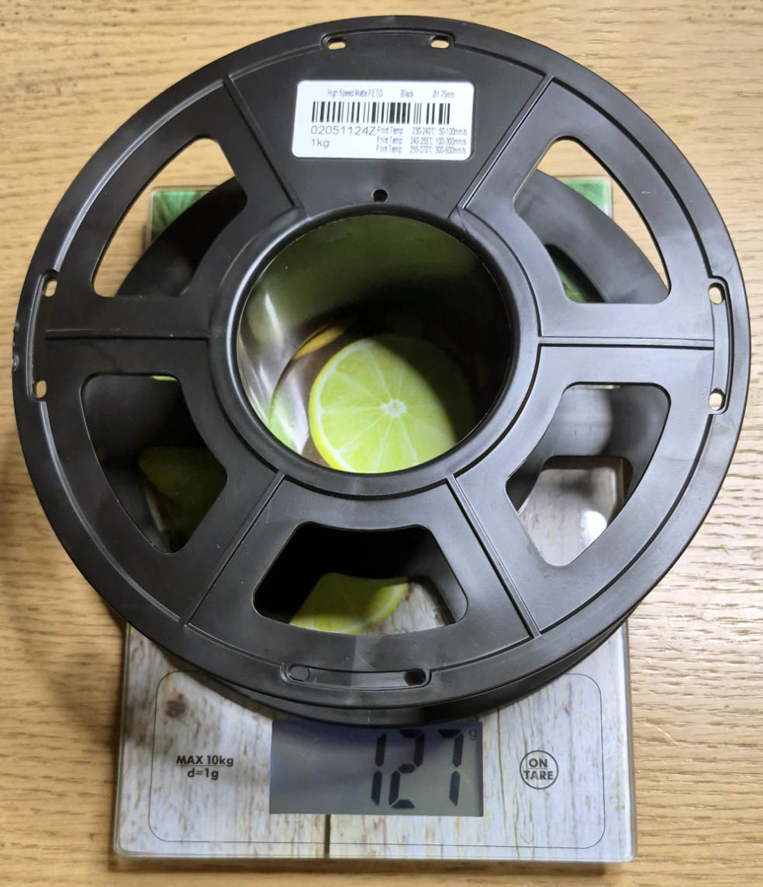

+++
draft = false
image = "img/portfolio/spool_tecbears_hs_matte_petg_1kg.jpg"
showonlyimage = false
date="2026-10-28"
title = "Tecbears High Speed Matte PETG 1kg"
[params]
  spool_type = 'dark_plastic'
+++

* Printing temp: 230 C – 270 C
* Bed temp: 85 C
* Empty spool weight: 127 g
* Advertised filament weight: 1000 g
* Outside Diameter: 196 mm
* Height: 58 mm
* Hole Diameter: 72.5 mm
<!--more-->

* Speed dependent temps: 230-240 C at 50-100 mm/s, 240-255 C at 100-300 mm/s, 255-270 C at 300-600 mm/s

